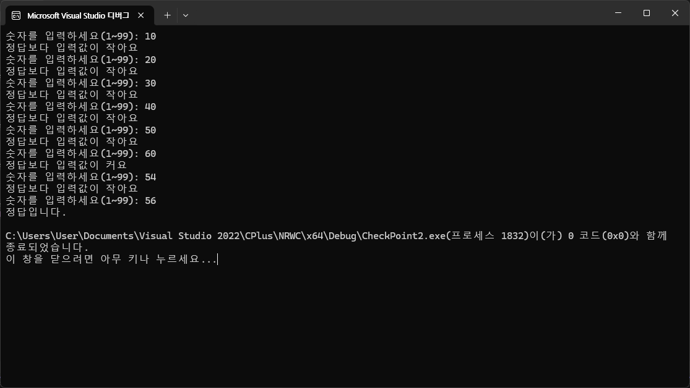
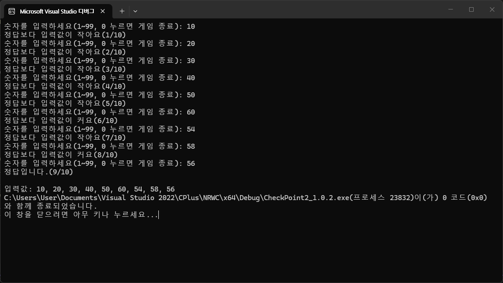

## 오늘 한 일

1. [실습] CheckPoint2_1: CheckPoint2의 함수화
```cpp
#include <iostream>

int GetUserNum();
bool CompareNum(int inputNum, int randomNum);

int main()
{
	int randomNum = 56;
	int inputNum = 0;

	while (true)
	{
		inputNum = GetUserNum();
		bool bKeepGoing = CompareNum(inputNum, randomNum);
		if (!bKeepGoing)
		{
			break;
		}
	}

	return 0;
}

int GetUserNum()
{
	int input;
	while (true)
	{
		std::cout << "숫자를 입력하세요(1~99): ";
		std::cin >> input;

		if (input >= 1 && input <= 99)
		{
			return input;
		}

		std::cout << "잘못된 입력입니다. 1~99 사이의 숫자를 입력하세요!!" << std::endl;
	}
}

bool CompareNum(int inputNum, int randomNum)
{
	if (inputNum < randomNum)
	{
		std::cout << "정답보다 입력값이 작아요" << std::endl;
		return true;
	}
	else if (inputNum > randomNum)
	{
		std::cout << "정답보다 입력값이 커요" << std::endl;
		return true;
	}
	else
	{
		std::cout << "정답입니다." << std::endl;
		return false;
	}
}
```



2. [실습]CheckPoint2의 기능 추가하기
```text
* 숫자 맞추기 게임(Ver1.0.2)
* 반복문 추가(정답을 맞추거나 0을 입력하면 종료)
* 함수화 추가
* 입력예외처리 하지 않음!!
* ---------------------------------------------
* int tryCount;
* 시도한 횟수 출력
* 정답보다 입력값이 커요(1/10)
* 정답보다 입력값이 작아요(1/10)
* 정답입니다(5/10)
* 최대 입력 제한(10회) 넘어가면  게임 종료
* ---------------------------------------------
* 캐싱처리 (입력값을 모두 보여주기)
* 1, 20, 45, 56 입력
* "입력값: 1, 20, 46, 56"
* 게임종료
```
```cpp
#include <iostream>

int GetUserNum();
bool CompareNum(int inputNum, int randomNum);
void PrintCount(int tryCount, int const maxCount);
void PrintCachedNums(int tryCount, int* const arrInputNums);

int main()
{
int randomNum = 56;
int inputNum = 0;
int tryCount = 0;
int const maxCount = 10;
int arrInputNums[maxCount] = { 0, };

	while (true)
	{
		inputNum = GetUserNum();
		if (inputNum == 0)
		{
			std::cout << "게임을 중단합니다." << std::endl;
			break;
		}
		arrInputNums[tryCount] = inputNum;
		++tryCount;
		bool bKeepGoing = CompareNum(inputNum, randomNum);
		PrintCount(tryCount, maxCount);
		if (!bKeepGoing)
		{
			PrintCachedNums(tryCount, arrInputNums);
			break;
		}
		if (tryCount >= 10)
		{
			std::cout << "시도 가능 횟수(" << maxCount << "회) 초과" << std::endl;
			PrintCachedNums(tryCount, arrInputNums);
			break;
		}
	}
	
	return 0;
}

int GetUserNum()
{
	int input;
	while (true)
	{
		std::cout << "숫자를 입력하세요(1~99, 0 누르면 게임 종료): ";
		std::cin >> input;
	
		if (input >= 0 && input <= 99)
		{
			return input;
		}
	
		std::cout << "잘못된 입력입니다. 1~99 사이의 숫자를 입력하세요!!" << std::endl;
	}
}

bool CompareNum(int inputNum, int randomNum)
{
	if (inputNum < randomNum)
	{
		std::cout << "정답보다 입력값이 작아요";
		return true;
	}
	else if (inputNum > randomNum)
	{
		std::cout << "정답보다 입력값이 커요";
		return true;
	}
	else
	{
		std::cout << "정답입니다.";
		return false;
	}
}

void PrintCount(int tryCount, int const maxCount)
{
	std::cout << "(" << tryCount << "/" << maxCount << ")" << std::endl;
	}
	
	void PrintCachedNums(int tryCount, int* const arrInputNums)
	{
	std::cout << std::endl;
	std::cout << "입력값: ";
	for (int i = 0; i < tryCount; i++)
	{
		std::cout << arrInputNums[i] << (i == tryCount - 1 ? "" : ", ");
	}
}

```

2. 포인터와 함수
	1. CallByValue: 원본 안 바뀜(UE5에서 변수 Copy)
	2. CallByReference / CallBy Pointer: 원본 바뀜(UE5에서 변수 Reference)
3. 포인터와 배열
	1. 함수에서 배열을 변수로 쓸 때는 Pointer 또는 Reference로 전달해야한다. 단, Reference는 크기가 고정되기 때문에 Pointer를 더 많이 사용.

|        | 선언 초기화                                                                                                      | 함수 파라미터                                                    | 값 참조                                                                                      |
| ------ | ----------------------------------------------------------------------------------------------------------- | ---------------------------------------------------------- | ----------------------------------------------------------------------------------------- |
| 1차원 배열 | `int arr[3]={1, 2, 3};`<br>`int arr[]={1, 2, 3};`<br>`int arr[]={0, }; //모두 0`<br>`int arr[3]; // 모두 쓰레기 값` | `void Func(int pArr[])`<br>`void Func(int *pArr)`          | `pArr[0]; //*(pArr + 0)`<br>`parr[2]; //*(parr + 2)`                                      |
| 2차원 배열 | `int arr2[3][2]={{1, 2}, {3, 4}, {5, 6}};`<br>`int arr2[][2]={{1, 2}, {3, 4}, {5, 6}};`                     | `void Func(int ppArr[][2]`<br>`void Func(int (*ppArr)[2])` | `ppArr[0][1];`<br> `//*(*(ppArr + 0) + 1`<br>`//(/(ppArr + 0))[1]`<br>`//*(ppArr[0] + 1)` |
4. [실습]NumberRun 함수화
   ```cpp
#include <iostream>

/*
* CallByValue		(값에 의한 호출)
* CallByReference	(주소에 의한 호출)
*/

void SwapByValue(int a, int b);
void SwapByRefrence(int& a, int& b);
void SwapByPointer(int* a, int* b);

int main()
{
	int num1 = 0;
	int num2 = 99999;

	std::cout << "SwapByValue Before num1: " << num1 << ", num2: " << num2 << std::endl;
	SwapByValue(num1, num2);
	std::cout << "SwapByValue After num1: " << num1 << ", num2: " << num2 << std::endl;

	std::cout << "SwapByRefrence Before num1: " << num1 << ", num2: " << num2 << std::endl;
	SwapByRefrence(num1, num2);
	std::cout << "SwapByRefrence After num1: " << num1 << ", num2: " << num2 << std::endl;

	std::cout << "SwapByPointer Before num1: " << num1 << ", num2: " << num2 << std::endl;
	SwapByPointer(&num1, &num2);
	std::cout << "SwapByPointer After num1: " << num1 << ", num2: " << num2 << std::endl;

	return 0;
}

void SwapByValue(int a, int b)
{
	std::cout << "Before x: " << a << ", y: " << b << std::endl;

	int temp = a;
	a = b;
	b = temp;

	std::cout << "After x: " << a << ", y: " << b << std::endl;
}

void SwapByRefrence(int& a, int& b)
{
	std::cout << "Before x: " << a << ", y: " << b << std::endl;

	int temp = a;
	a = b;
	b = temp;

	std::cout << "After x: " << a << ", y: " << b << std::endl;
}

void SwapByPointer(int* a, int* b)
{
	std::cout << "Before x: " << *a << ", y: " << *b << std::endl;

	int temp = *a;
	*a = *b;
	*b = temp;

	std::cout << "After x: " << *a << ", y: " << *b << std::endl;
}
   ```
5. OOP 키워드(C++ 클래스 이해)
	1. OOP(Object-Oriented Programming. 객체 지향 프로그래밍)
	2. 생성자

---

## 배운 점

1. pointer 관련된 예제는 외우자.
	```cpp
	int num=100;
	int* ptr = &num;
	float* fPtr = nullptr;
	*ptr = 9999;
	```
2. 함수는 의미 있는 이름으로 짓자. 간결하게 작성하고 함수 1개가 일을 하나만 하도록 하자. 
3. Reference와 Pointer 비교
4. 포인터로 받은 변수는 함수 안에서 원본이 직접 수정되므로 return으로 돌려줄 필요가 없다 → void

---

## 해야 할 일

1. 데이터구조에서 스택? 힌 영역?
2. new와 delete
			1. name.h 에 선언 > name.cpp에 가져다 사용`
